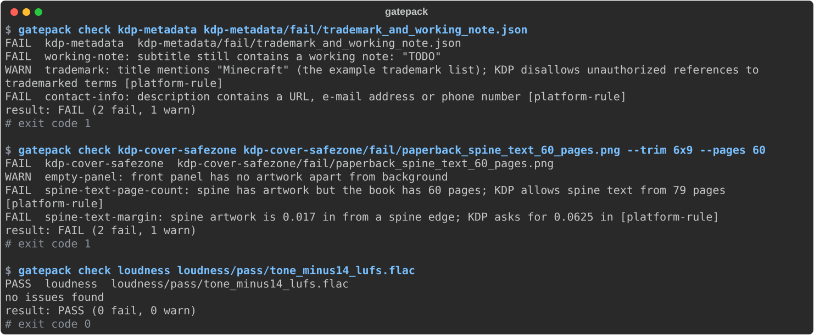

# gatepack

Check a book file or a video before you publish it. Each gate is one rule set with a cited source,
a PASS/WARN/FAIL verdict, JSON output and an exit code, so a person, a CI job or an AI agent can stop
a bad upload before the platform does.



<sub>Real output on this repository's test fixtures, made by [`scripts/make_demo_svg.py`](scripts/make_demo_svg.py). The `measured:` and `rule sources:` lines are left out of the picture to keep it readable.</sub>

**Contributions welcome.** One gate = one pull request: a rule, its source, a PASS file and a FAIL file.
[15 gates are waiting for an owner](https://github.com/Essa366/gatepack/issues?q=is%3Aissue+is%3Aopen+label%3A%22good+first+issue%22), each with its rule source and test files described ([list](docs/first-issues.md)).

## Quick start

```bash
pip install "gatepack[cover]"          # Python 3.10+; installs pypdf, and Pillow for the cover gate
gatepack list                          # what can be checked
gatepack check loudness clip.mp4       # needs ffmpeg on PATH for audio/video gates
```

Before the first PyPI release, install from the repository:
`pip install "gatepack[cover] @ git+https://github.com/Essa366/gatepack"`.

Exit codes: `0` PASS or WARN, `1` FAIL (or WARN with `--strict`), `2` the gate could not run.
Add `--json` for machine-readable output.

## Gates

| Gate | Checks | Rule source |
|---|---|---|
| [`kdp-metadata`](docs/gates/kdp-metadata.md) | title length, trademarks, sales-rank claims, contact details, review requests, coloring/puzzle books listed as eBooks, trim size and counts that contradict the book, leftover TODOs | [KDP Metadata Guidelines](https://kdp.amazon.com/en_US/help/topic/G201097560), [Keywords](https://kdp.amazon.com/en_US/help/topic/G201298500), [Kindle Content Quality](https://kdp.amazon.com/en_US/help/topic/G200952510) |
| [`kdp-cover-safezone`](docs/gates/kdp-cover-safezone.md) | cover size, artwork in the trim, wrap and hinge zones, spine text rules | [Paperback cover](https://kdp.amazon.com/en_US/help/topic/G201953020), [Hardcover cover](https://kdp.amazon.com/en_US/help/topic/GDTKFJPNQCBTMRV6) |
| [`kdp-pagecount`](docs/gates/kdp-pagecount.md) | page count limits, page size vs trim and bleed, pages promised in the listing | [Print Options](https://kdp.amazon.com/en_US/help/topic/G201834180), [Trim, Bleed, Margins](https://kdp.amazon.com/en_US/help/topic/GVBQ3CMEQW3W2VL6) |
| [`epub`](docs/gates/epub.md) | mimetype, container, required metadata, missing files, broken XHTML, author name; runs EPUBCheck if installed | [EPUB 3.3](https://www.w3.org/TR/epub-33/), [EPUBCheck](https://github.com/w3c/epubcheck) |
| [`dead-air`](docs/gates/dead-air.md) | long silences, silent start, silent file | heuristic, measured with [silencedetect](https://ffmpeg.org/ffmpeg-filters.html#silencedetect) |
| [`freeze`](docs/gates/freeze.md) | picture that stops changing | heuristic, measured with [freezedetect](https://ffmpeg.org/ffmpeg-filters.html#freezedetect) |
| [`loudness`](docs/gates/loudness.md) | integrated LUFS and true peak for streaming, podcast or broadcast | [Spotify](https://support.spotify.com/us/artists/article/loudness-normalization/), [Apple Podcasts](https://podcasters.apple.com/support/893-audio-requirements), [EBU R 128](https://tech.ebu.ch/publications/r128) |
| [`tail`](docs/gates/tail.md) | ending cut off mid-sound, audio longer or shorter than the picture | heuristic |

Every finding says where it comes from: `platform-rule` (a platform's help page), `standard`
(a published standard), or `heuristic` (a threshold we chose and document, which you can change).

## Examples

```bash
# Kindle eBook metadata, with your own list of trademarks to avoid
gatepack check kdp-metadata book.json --brands my-brands.txt

# Paperback interior: page limits and 6 x 9 trim with or without bleed
gatepack check kdp-pagecount interior.pdf --trim 6x9 --metadata book.json

# Full wrap cover (PNG/JPEG, or PDF with PyMuPDF installed)
gatepack check kdp-cover-safezone cover.png --trim 6x9 --pages 120
gatepack check kdp-cover-safezone cover.pdf --format hardcover --trim 6x9 --spine 0.6

# Podcast episode against Apple's -16 LUFS, as JSON for a CI step
gatepack check loudness episode.mp3 --profile podcast --json

# Every short in a folder, blocking on warnings too
gatepack check dead-air renders/*.mp4 --strict
```

From Python:

```python
import gatepack

result = gatepack.check("tail", "short.mp4")
print(result.status, [f.message for f in result.findings])
```

## Use it from Claude Code

The repository is also a Claude Code plugin with a `gatepack` skill that tells the agent which gate to
run before it reports a file as ready to upload:

```text
/plugin marketplace add Essa366/gatepack
/plugin install gatepack@gatepack
```

The skill is in [`skills/gatepack/SKILL.md`](skills/gatepack/SKILL.md). Other agents can read the same file.

## What it does not do

- It does not guarantee that KDP, a podcast host or a video platform will accept your file. Human
  reviewers apply rules no tool can see.
- It never logs in, uploads, scrapes or publishes anything. gatepack makes no network calls, and it runs
  ffmpeg with a file-only protocol whitelist so a playlist cannot pull in URLs.
- It is not a trademark database. The built-in list is a short example; bring your own.

## Add a gate

```bash
git clone https://github.com/Essa366/gatepack && cd gatepack
pip install -e ".[dev]"
gatepack new youtube-thumbnail --category image   # writes the module, docs page and fixture folders
```

Fill in the rule and its source, add one file that must PASS and one that must FAIL, run `pytest`.
The full walk-through is in [docs/adding-a-gate.md](docs/adding-a-gate.md), the rules for pull
requests in [CONTRIBUTING.md](CONTRIBUTING.md).

## How it was built

Written with Claude Code. The KDP rules come from book uploads that were rejected or flagged, and each
one is checked against the platform page linked above. If a rule here disagrees with the platform's
current page, the page wins: please open an issue.

## License

[MIT](LICENSE)
